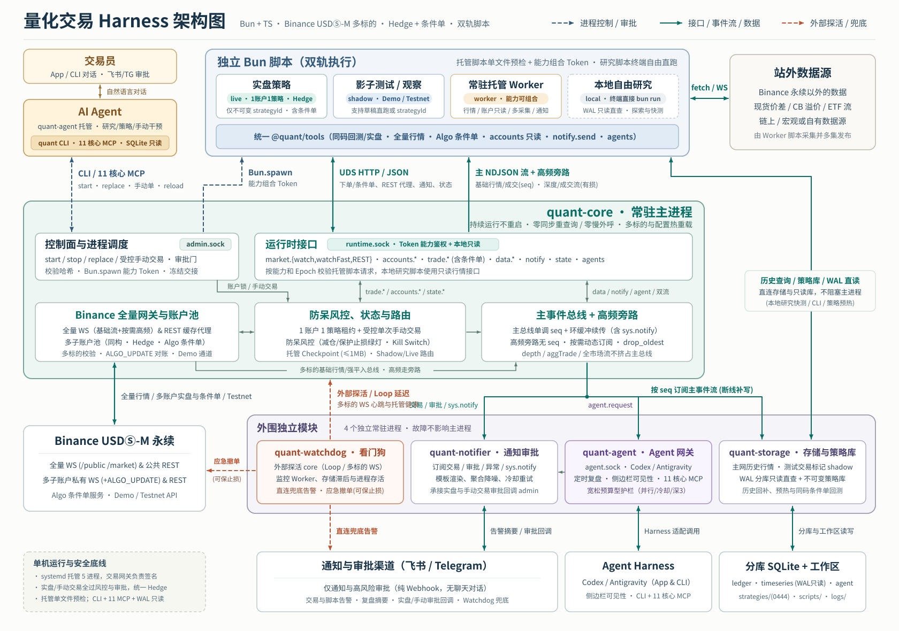

# quant-harness

## 项目愿景

在一台带公网 IP 的独立服务器上运行个人 Agent 量化交易工具（面向 **Binance USDⓈ-M 永续合约**，默认 `BTCUSDT`，支持多标的观测与按账户配置交易标的）。

平时主要通过 **Codex App / Antigravity App 的 SSH Connect** 打开远端项目、或 SSH 登录终端用 Codex CLI / Antigravity CLI 与 Agent 对话，由 Agent 负责数据研究、编写脚本、管理策略、必要时执行经授权的单次手动干预以及定期复盘；手机上的 **飞书 / Telegram** 仅用于接收交易告警、脚本自定义提醒、复盘摘要通知及高风险变更审批：

- **自由研究 + 托管运行双轨驱动**：
  - **终端自由直跑**：一次性数据分析、统计归因、向量化快测与参数扫描，由 Agent 在终端直接 `bun run` 执行（纯 Bun + TS，支持直接只读查询本地 WAL SQLite 与行情快照），秒级迭代，不走异步托管流程。
  - **常驻托管运行**：实盘策略、Demo/Testnet 联调策略、7×24 行情/账户监听与外部数据采集脚本由 `quant-core` 统一托管保活；支持按需组合行情、只读账户观测、多数据集发布、直接推送飞书/Telegram 告警及异步唤起 Agent 会话（默认在远端 App 侧边栏 `visible` 可见，并同步推送摘要通知）。
- **确定性盘中执行 + 零中断迭代**：盘中高频/自动化策略执行由独立确定性 Bun 脚本完成（支持交易所原生条件止损/止盈单），每个子账户同一时间最多运行 1 个实盘策略（统一 Hedge Mode 双向持仓）；交易员也可在对话中授权 Agent 发起经风控与审批的单次手动交易干预（平仓、挂条件止损、撤单、调杠杆）；实盘策略支持先经本地快测/标准同码回测、Demo/Testnet 草稿直跑（`shadow`）与小资金子账户验证，在 `quant-core` 不重启的前提下热替换（`replace`）。
- **策略资产长期沉淀**：成熟策略经封存成为只读不可变脚本文件持久化保存，配合衍生谱系、五维标签与验证归因记录，方便未来行情回归时检索、复用与二次衍生。

---

## 核心原则与边界

以下约束用于指导全部设计与编码，在守住实盘安全底线的前提下最大化 Agent 与脚本效率：

1. **信任 Agent，守住少而硬的实盘底线**
   - 本项目是个人单机工具，信任已接入的 Agent，**不做** OS 多用户隔离、`systemd DynamicUser` 脚本沙箱、挂载命名空间或重型防贼鉴权体系。
   - 真正守死的硬底线仅三条：**交易所 API 密钥隔离**（仅驻留 `quant-core` 与可选应急 `quant-watchdog`，绝不暴露给脚本或 Agent，且禁用提币/划转）、**实盘交易风控与审批闸门**（所有策略与手动交易统一经 `quant-core` 风控/限频/审批/审计）、**已封存实盘版本不可原地篡改**（须 `fork` 衍生新版本）。
2. **极简单机，全栈纯 Bun + TypeScript**
   - 全栈 **Bun + TypeScript**，无 Redis、消息队列、Docker、ORM、Web 框架或重型 Bot SDK。
   - 托管与封存脚本坚持**单文件 `.ts` + 仅运行时导入 `@quant/tools` + 静态预检与单文件打包**，保证策略自包含、易审阅、零依赖腐烂；一次性研究脚本亦采用纯 Bun + TS（可直接使用 Bun 原生能力与只读 `bun:sqlite`）。
   - 仅 5 个常驻服务由 `systemd` 托管；所有托管脚本由 `quant-core` / `quant-storage` 通过 **`Bun.spawn`** 直接拉起（PID 记入状态库用于重启清理孤儿进程）。
   - 存储使用 `bun:sqlite`（WAL 分库，天然支持并发只读直查），本机进程通信使用 UDS HTTP/JSON + NDJSON 流，飞书/Telegram 采用公网 HTTPS 反代下的纯 Webhook + 原生 `fetch()`。
3. **直连 Binance USDⓈ-M 全量能力，拒绝过度抽象**
   - 交易所直写 **Binance USDⓈ-M Futures**，不设计多交易所插件框架，但完整对齐 Binance 官方永续行情流（分 `/public` 与 `/market` 路由，基础流落盘 + 高频流按需无 `seq` 旁路）、官方 Market Data REST（经统一限频缓存代理）以及新版 Algo Order 原生条件单（`STOP_MARKET` / `TAKE_PROFIT_MARKET` / `STOP` / `TAKE_PROFIT` / `TRAILING_STOP_MARKET`）。
   - 所有实盘子账户在代码层完全同构，仅靠每账户配置（`allowedSymbols`、`requireApproval`、`marginType`、风控阈值、`labels`）区分灰度账户与主力账户。
   - 仅在明确需要多后端的 **Agent Harness 适配层（Codex / Antigravity）** 保留最小接口抽象，统一控制远端 App 侧边栏可见性（`visible` / `hidden` / `ephemeral`）。
4. **真实验证，不写模拟策略脚本**
   - 仓库内不编写示例假策略、模拟行情生成器或内置实时 Paper 撮合引擎；策略验证依靠真实历史数据回放、`shadow`（直连 Binance Demo/Testnet，支持草稿直接联调）与小资金真实子账户。
5. **CLI + 精简核心 MCP + 只读直查协同**
   - 提供统一本机 CLI `quant`（覆盖全部查询、运维与控制操作，支持 `--json`）并开放本地 SQLite WAL 只读直查，充分释放 Coding Agent 的原生 Shell、SQL 与脚本迭代能力；MCP 精简为 11 个高频强契约核心工具，与 `quant` CLI 共享同一套控制面契约与审计日志。

---

## 架构总览

- **1 个常驻主进程 + 4 个独立外围进程**（任一外围模块重启或故障不中断实盘交易）：
  - `quant-core`：常驻交易与行情内核（不重启），承载 Binance USDⓈ-M 全量公共行情（基础流 + 按需高频旁路 + REST 代理缓存）、多子账户池（含 Algo 条件单与私有流对账）、账户独占锁与防呆风控、受控手动交易入口、托管 Checkpoint、`Bun.spawn` 脚本调度与持久化有序事件总线。
  - `quant-storage`：订阅主事件流异步落盘至分库 SQLite（`ledger.db` / `timeseries.db`，同时对 Agent/本地研究脚本开放 WAL 只读直查）与滚动日志，管理不可变策略资产库，承接历史数据回补、预热与标准同码离线回测。
  - `quant-notifier`：飞书与 Telegram 通知与审批 Bot（纯 Webhook），订阅交易、审批及脚本自定义通知事件（`sys.notify`），负责告警聚合降噪、复盘摘要推送、实盘与手动交易审批卡片交互及管理员指令。
  - `quant-agent`：复用 Codex / Antigravity 的 Agent 会话与任务网关（`agent.sock`），承接定时全局复盘、脚本异步唤起（以预算与合理上限为主的轻量护栏）与远端 App 侧边栏可见性控制（默认 `visible`），任务完成后经 `quant-notifier` 推送通知摘要。
  - `quant-watchdog`：独立外部看门狗，探测 5 进程健康、Event Loop 延迟与多标的行情新鲜度，持有直连 IM 兜底告警与可选极端失联应急撤单（可配置保留保护性条件止损单）。
- **3 类托管脚本角色（`Bun.spawn` + `QUANT_TOKEN` + `@quant/tools`）+ 本地自由研究脚本**：
  - `live`：1 子账户 1 实盘策略，仅按不可变 `strategyId` 运行，受账户独占 Epoch 锁与防呆风控约束，支持原生条件单、直接发通知与可选输出自定义指标数据集。
  - `shadow`：直连 Binance Demo/Testnet 账户池联调与观察，支持直接运行 `_drafts/` 草稿或已封存 `strategyId`（均经预检打包并记录 `code_hash`，不污染不可变策略库）。
  - `worker`：统一非交易常驻托管脚本（合并监听、风控盯盘与外部数据采集），启动时按需组合能力：`market`（全量行情）、`account_read`（只读指定账户余额/双腿持仓/挂单/成交回报）、`data_publish`（独占发布 1 个或多个 `dataset`）、`notify`（直发飞书/TG 告警）、`agent_task`（唤起 Agent）、`state`（独立 Checkpoint）。
  - `local`（非托管终端直跑）：位于 `scripts/research/` 的纯 Bun + TS 一次性研究、探索、向量化快测与参数扫描脚本，由 Agent 终端直接 `bun run`，只读访问本地 SQLite WAL 或本地只读接口，零托管开销。

---

## 文档导航

| 文件 | 说明 |
| :--- | :--- |
| [docs/architecture.md](./docs/architecture.md) | 架构设计（系统边界、进程拓扑、全量行情分层、工作区与策略资产、CLI/MCP 工具集与故障恢复） |
| [docs/architecture.svg](./docs/architecture.svg) | 架构图（矢量源文件） |
| [docs/design.md](./docs/design.md) | 详细工程设计（目录结构、配置、UDS/事件契约、Binance 全量行情与 Algo 条件单网关、SQLite DDL、Agent 适配、CLI/MCP 与分阶段验收） |
