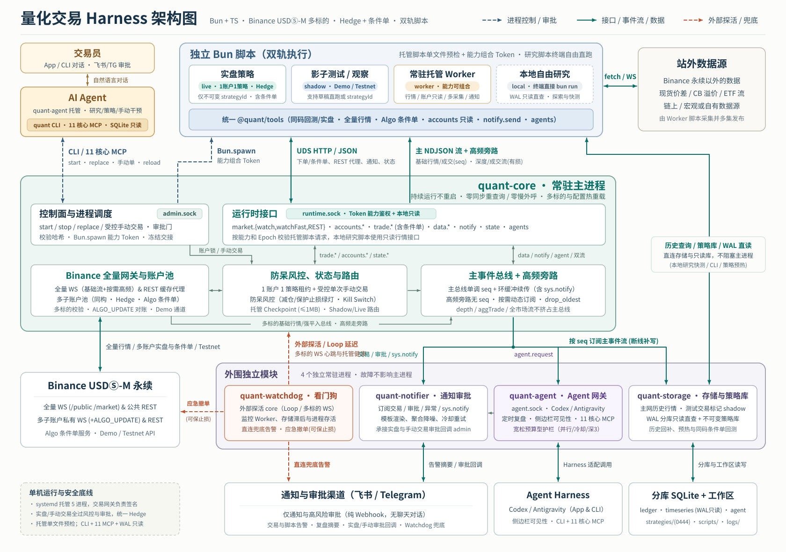

# 量化交易 Harness 架构设计



---

## 1. 系统边界

- **运行环境**：单机部署，全栈 Bun + TypeScript，由 `systemd` 同级托管 5 个常驻进程（1 核 + 4 外围），无 Redis、消息队列或容器编排。
- **交易标的**：`BTC/USDT` U 本位永续合约。
- **账户与持仓模型**：
  - 多子账户隔离，**单子账户同一时间至多运行 1 个实盘策略（1:1 独占）**；交易所子账户余额、持仓与挂单即唯一账本。
  - 所有实盘子账户在代码层完全同构，仅通过每账户独立配置（`requireApproval`、风控阈值、`labels`）区分小资金灰度账户与主力账户。
  - 所有子账户统一启用 **Hedge Mode（双向持仓）**。
- **策略资产模型**：策略以不可变 `.ts` 脚本文件持久化存储；基于旧策略修改采用 Copy-on-Write 复制衍生新版本并记录谱系，配合五维正交标签支持按市场状态检索与唤醒。
- **人机分工**：交易员通过手机 IM 或自然语言与 AI Agent 对话，并通过 IM 完成高风险审批；AI Agent 由 `quant-agent` 托管，负责策略衍生/封存、采集脚本编写、回测与复盘，**所有脚本启停与策略管理的唯一入口为 Agent Tool Call**。AI Agent 仅工作在离线/异步闭环中，**不参与盘中实时下单决策**；所有盘中交易执行由确定性 Bun 脚本完成。
- **上线路径**：`离线回测 (readonly)` → `Shadow（交易所 Demo / Testnet API）` → `小资金子账户灰度 (live)` → `主力子账户 (live)`。

---

## 2. 进程拓扑

| 进程 | 类型 | 核心职责 | 故障隔离边界 |
| :--- | :--- | :--- | :--- |
| **`quant-core`** | 常驻主进程 | 交易所网关与多子账户池、账户独占锁与防呆风控、托管 Checkpoint、脚本调度、内存有序事件总线 | 核心交易链路；持续运行不重启，无同步重查询、无慢速外呼、无用户脚本代码，支持配置热重载 |
| **`quant-storage`** | 外围常驻进程 | 订阅事件流异步批量落盘、分库存储与日志滚动、不可变策略库索引、承接历史查询 / 回补 / 预热 / 回测读取 | 重启或故障不影响 `quant-core`；恢复后按 `seq` 断点补写 |
| **`quant-notifier`** | 外围常驻进程 | 交易/审批/异常通知投递、降噪冷却重试、承接 IM 实盘审批交互并回调 `admin.sock` | 重启或外网超时不影响 `quant-core` |
| **`quant-agent`** | 外围常驻进程 | 复用 Codex 等现有 Agent Harness、对外暴露 `agent.sock` 任务接口、手机 IM 对话、定时全局复盘、承接脚本发起的受限任务 | 重启或 LLM 慢响应不影响 `quant-core` 与告警通道 |
| **`quant-watchdog`** | 外围常驻进程 | 外部探活 `quant-core` 与外围进程、独立直连兜底告警、可选极端失联应急撤单 | 独立于 `quant-core` 之外，持独立告警通道 |
| **独立 Bun 脚本进程** | 隔离工作进程 | 运行实盘策略、Shadow 测试/观察、外部数据采集、研究/回测脚本 | 进程级隔离，单脚本崩溃或阻塞不影响主进程及其他脚本 |

本机进程间通信统一采用 **Unix Domain Socket（UDS）上的 HTTP/1.1 + JSON 与 NDJSON 持续流**。

---

## 3. 核心常驻进程：`quant-core`

### 3.1 控制面与进程调度（`admin.sock`）

脚本生命周期控制统一收口为 **Agent Tool Call**（经薄 MCP / Tool Server 向 `admin.sock` 发送本地 HTTP JSON 请求），不提供面向用户的命令行脚本启动入口：

- **控制操作**：`start` / `stop` / `replace` / `approve` / `status` / `reload`（热重载风控参数与子账户配置）。
- **脚本拉起与审批门**：
  1. `shadow` 与 `live` 仅接受已封存的不可变 `strategyId`（如 `butterfly-grid@v3`），启动前校验文件只读状态与 `code_hash`；`readonly` / `collector` 校验脚本路径并记录源码哈希；
  2. **免审批路径**（`readonly`、`collector`、`shadow`、或目标子账户配置 `requireApproval: false`）：立即 `Bun.spawn(["bun", "run", entryPath], { env })` 并返回 `{ runId, pid, status }`；
  3. **审批路径**（目标子账户配置 `requireApproval: true` 的上线/`replace`，或调宽风控上限）：绑定 `strategyId + code_hash` 返回 `{ status: "pending_approval", proposalId }`，经 `quant-notifier` 推给交易员；交易员通过 IM 审批回调 `admin.sock` 确认后再执行切换与 `Bun.spawn`。
- **子进程环境注入**：拉起托管脚本时注入只读环境变量：`QUANT_SOCKET`（`runtime.sock`）、`QUANT_STORAGE_SOCKET`（`quant-storage`）、`QUANT_TOKEN`、`QUANT_MODE`、`QUANT_RUN_ID`、`QUANT_ACCOUNT`、`QUANT_EPOCH`。

### 3.2 脚本通信协议与能力隔离（`runtime.sock`）

所有脚本均由 `quant-core` 托管拉起并统一 `import @quant/tools`，SDK 自动读取环境变量并封装底层传输；`runtime.sock` 拒绝未携带有效 `QUANT_TOKEN` 的请求（`401`）。

#### 通信信道

| 方向 | 协议与载体 | 语义 |
| :--- | :--- | :--- |
| **脚本 → `quant-core`** | UDS HTTP + JSON（`Authorization: Bearer <QUANT_TOKEN>`） | 命令、状态读写与异步任务触发（`/v1/trade/*`、`/v1/state/*`、`/v1/data/publish`、`/v1/agents/tasks`），返回 JSON 或结构化错误码（`401` / `403` / `409 STALE_EPOCH` / `429` / `502`） |
| **`quant-core` → 脚本** | UDS 长连接 HTTP + NDJSON（`GET /v1/stream?topics=...&after_seq=...`） | 实时事件推流（行情、外部数据集、成交回报、`sys.handover`）；SDK 封装为 `for await` 迭代，断线自动带最后 `seq` 重连补齐 |
| **脚本 → `quant-storage`** | UDS HTTP + JSON（经 `QUANT_STORAGE_SOCKET`） | 历史 K 线、外部数据集与日志读取及启动预热，不经过 `quant-core` |
| **脚本 ↔ `quant-core`（OS）** | `stdout/stderr` 管道 + `SIGTERM` | 自动收集 `console.log/error` 打标写入滚动日志；`stop/replace` 时下发 `sys.handover` + `SIGTERM`，经 `harness.onHandover(cb)` 在 2~3 秒内提交终态退出，超时 `SIGKILL` |

#### 模式权限矩阵

`quant-core` 内存维护 `Map<token, Session>`，按角色强制隔离能力：

| 角色（`mode`） | 启动方式 | 行情 / 数据流 | `data.publish` | `trade.*` | `state.save / load` | `agents.startTask` |
| :--- | :--- | :---: | :---: | :--- | :--- | :---: |
| **`live`** | Tool Call → `admin`（绑定唯一 `account_id`） | 允许 | 拒绝 | 实盘路由（校验 `account_id → activeEpoch` + 防呆风控） | 绑定 `account_id`（校验 `activeEpoch`） | 允许（经护栏） |
| **`shadow`** | Tool Call → `admin` | 允许 | 拒绝 | Shadow 路由（同风控 + 交易所 Demo / Testnet API） | 独立命名空间 `shadow:<run_id>` | 允许（经护栏） |
| **`collector`** | Tool Call → `admin` | 允许 | 允许（限已声明 `dataset`） | 拒绝（403） | 独立命名空间 `collector:<name>` | 允许（经护栏） |
| **`readonly`** | Tool Call → `admin`（研究 / 监听 / 回测） | 允许（或直连 `storage`） | 拒绝（403） | 拒绝（403） | 独立命名空间 `readonly:<name>` | 允许（经护栏） |

#### `@quant/tools` 核心原语（统一 Hedge Mode）

```ts
// 双向持仓四原语（底层映射为 side + positionSide，不依赖 reduceOnly）
trade.openLong(params: OrderParams)   // BUY  + positionSide: LONG
trade.closeLong(params: OrderParams)  // SELL + positionSide: LONG（最多平至 0，不反手开空）
trade.openShort(params: OrderParams)  // SELL + positionSide: SHORT
trade.closeShort(params: OrderParams) // BUY  + positionSide: SHORT（最多平至 0，不反手开多）
trade.cancel(orderId | clientOrderId)
trade.cancelAll()
trade.positions()                     // { long, short } 双腿持仓
trade.openOrders()

// 异步触发 Agent 任务（投递 agent.request 事件，不阻塞脚本循环；默认在远端 App 侧边栏可见）
agents.startTask({ dedupKey, prompt, title?, backend?, visibility?, context? }) // 返回 { taskId }
agents.getTask(taskId)
```

同一份策略代码在回测、`shadow` 与所有实盘子账户下零改动运行，由注入的 Transport 与 Token 决定执行去向。

### 3.3 交易所网关与多账户池

1. **共享公共行情通道（全局单连接）**：合并订阅 `BTCUSDT` 永续 K 线、最新 Ticker / 盘口最优价、标记价格（`markPrice`）与资金费率（`fundingRate`），写入内存事件总线。
2. **多子账户池（`Account Pool`）**：
   - 所有实盘子账户代码路径完全同构，按 `account_id` 独立配置 API 凭证、`requireApproval`、防呆风控阈值与 `labels`，各自维护私有订单/仓位回报 WS 与交易 REST 客户端：
     ```json
     {
       "sub_small": { "requireApproval": false, "risk": { "maxOrderNotionalUsd": 100,  "maxLeverage": 5,  "maxOrdersPerMin": 20 }, "labels": ["canary"] },
       "sub_main":  { "requireApproval": true,  "risk": { "maxOrderNotionalUsd": 5000, "maxLeverage": 10, "maxOrdersPerMin": 30 }, "labels": ["prod"] }
     }
     ```
   - **启动持仓模式校验**：初始化检查子账户持仓模式——非 `Hedge Mode` 且空仓无挂单时自动切换，存在持仓/挂单无法切换时拒绝激活该子账户并告警；
   - **按账户直连对账**：启动或私有 WS 断线重连后，直接按 `account_id` 拉取真实持仓与挂单同步状态；
   - **统一出口 IP 限频**：所有子账户 REST 请求经网关统一令牌桶节流，防止触发 IP 级限频。
3. **Shadow 测试通道**：承接 `shadow` 交易请求，直连交易所 Demo Trading / Testnet API（或按交易规则校验记录意图），与实盘凭证完全隔离。

### 3.4 账户独占锁、防呆风控与托管 Checkpoint

1. **账户级独占租约**：`accountLease: Map<AccountId, { strategyId, runId, epoch }>`。每个 `account_id` 同一时刻仅 1 个活跃 `live` 租约；占用时拒绝新 `start`，仅允许通过 `replace` 递增 `epoch` 交接，旧 `epoch` 请求统一返回 `409 STALE_EPOCH`。
2. **防呆风控与幂等**：
   - 下单频控（单账户单位时间最大下单/撤单次数）；
   - 参数合法性底线（拦截 `NaN` / 非正数 / 超出单笔名义上限 / 超出最大杠杆）；
   - 单子账户或全局一键 Kill Switch（立即拒绝开仓，可选联动撤单/平仓）；
   - 所有下单强制携带唯一 `clientOrderId` 幂等键。
3. **托管 Checkpoint（`state.save / state.load`）**：
   - 数据结构：`{ accountId, version, epoch, schemaVersion, updatedAt, data }`，单份硬上限 ≤ 128 KB，保存策略业务上下文（如移动止损高水位、网格/蝴蝶层级、冷却时间、状态机阶段）；
   - `live` 写入强校验 `activeEpoch` 防止旧版覆写；
   - `quant-core` 内存保留热份供即时读取，同步发 `state.checkpoint` 事件经总线追加归档历史版本至 `ledger.db`，并写本地原子热备文件（`tmp + rename`）。

### 3.5 内存事件总线（Event Bus）

- **全局有序**：所有事件分配单调递增 `seq` 与毫秒时间戳，主题包括 `market.*`、`trade.*`、`shadow.*`、`data.*`、`state.*`、`agent.*`、`sys.*`。
- **环形缓冲**：内存保留最近窗口事件，供消费端凭 `after_seq` 短时断线续传。
- **分层背压**：`market.*` / `data.*` 队列满时按策略 `drop_oldest` 或断开慢消费者；`trade.*` / `state.*` 严禁静默丢弃，积压超阈值触发高优告警与保护。

---

## 4. 外围独立模块

### 4.1 `quant-storage`（持久化存储与策略库）

- 持持久化游标 `last_seq` 订阅 `quant-core` 全量事件流批量落盘，重启从 `last_seq` 追平。
- **物理存储分层**：
  1. `ledger.db`（SQLite WAL）：委托/成交、账户快照、Shadow 记录、Checkpoint 历史版本、策略资产元数据与标签索引（`strategies` / `strategy_tags`）；
  2. `timeseries.db`（SQLite WAL）：`BTCUSDT` 历史 K 线、标记价/费率与外部采集因子数据集（按 TTL 归档清理）；
  3. `strategies/`：策略草稿区与只读不可变策略脚本文件目录；
  4. `logs/<role>/<name>/<run_id>.log`：按大小/日期滚动压缩的文本日志。
- 统一承接历史 K 线回补、策略预热、策略库检索、Agent Tool 查询与离线回测读取。

### 4.2 `quant-notifier`（通知与实盘审批网关）

- 订阅 `trade.*`、`sys.*` 及审批事件，渲染推送至独立配置的 **告警与审批 IM 频道（独立 Bot）**，内置同类告警聚合降噪、冷却防刷屏与重试队列。
- 承接交易员在 IM 中的实盘审批确认交互，校验交易员身份与提案哈希后回调 `admin.sock`。

### 4.3 `quant-agent`（Agent 会话与任务网关）

统一承接底层 Agent Harness 复用、手机 IM 对话、定时全局复盘与脚本主动发起任务：

- **统一对外接口（`agent.sock`）**：
  ```text
  POST /v1/tasks                  // 发起新任务/会话（返回 taskId, sessionId）
  POST /v1/sessions/:id/messages  // 向已有会话追加消息（resume 续聊）
  GET  /v1/tasks/:id              // 查询任务状态、耗时与输出摘要
  POST /v1/tasks/:id/cancel       // 取消运行中的任务
  ```
- **底层 Agent Harness 适配与侧边栏可见性**：通过薄 Adapter 复用现有 Agent Harness（如 Codex App Server 与 Antigravity `agy` / `agy acp`），支持按任务控制会话在远端 App 侧边栏的可见性（`visible` / `hidden` / `ephemeral`；`im_user`、`cron_review` 与 `script_triggered` 均默认 `visible`，便于直接从侧边栏打开续聊）。
- **手机 IM 双向对话（独立对话频道）**：
  - 与 `quant-notifier` 的告警审批 Bot 隔离运行；
  - 维护独立 `agent.db` 持久化 `im_thread_id ↔ session_id` 映射：新开话题发起新会话，原话题回复自动 `resume` 续聊；
  - 定时复盘或脚本发起的任务完成后自动在 IM 建话题输出报告，交易员可从 App 远端项目侧边栏或直接回复 IM 话题无缝接管该 `session_id` 继续迭代。
- **定时全局复盘（Cron Scheduler）**：内置定时调度（如每日 UTC 00:05、每周复盘），拉起 `cron_review` 任务汇总各子账户绩效、成交、Checkpoint 演进、采集健康与告警，结合当下 BTC 市场状态给在跑策略追加归因备注，并按 `regime` 标签从策略库检索可唤醒的 `shelved` 历史策略推送至 IM。
- **脚本触发任务与四道护栏**：订阅事件总线 `agent.request` 异步消费（零阻塞 `quant-core` 与脚本），施加：
  1. **指纹去重与冷却**：按 `(source_scope, dedupKey)` 在冷却窗口内合并重复请求（保留原 `taskId` 别名可查）；
  2. **并发、写锁与预算上限**：限制全局并发任务数、代码仓库写锁同时仅允许 1 个写会话、强制每日调用次数与费用上限；
  3. **Profile 提示词与审计约定**：已接入的可信 Agent 共享完整运维工具集，通过 Profile 提示词约定职责及何时先询问交易员（`im_user`、`cron_review`、`script_triggered`），所有控制面变更在服务端记录真实执行来源与审计日志；
  4. **反递归护栏（`maxDepth = 1`）**：脚本触发的 Agent 任务禁止递归触发新的脚本任务。

### 4.4 `quant-watchdog`（独立外部看门狗）

- 定时探测 `quant-core` 健康端点与 Event Loop 响应延迟，核查行情/私有 WS 新鲜度、实盘策略存活、`collector` 更新 TTL、`quant-storage` 落盘滞后（`core.seq - storage.last_seq`）、磁盘空间以及 `quant-notifier` / `quant-agent` 存活。
- 持有独立直连 IM 的兜底告警通道；支持配置极端失联应急撤单开关（可配合交易所原生 `Cancel-on-Disconnect`）。

---

## 5. 策略资产与版本管理（Strategy Registry）

### 5.1 不可变脚本与 Copy-on-Write 衍生

```text
strategies/
├── _drafts/                  # Agent 唯一可自由编辑的草稿工作区（允许预检与离线回测）
│   └── butterfly-grid-v4.ts
├── butterfly-grid/           # 策略族（family）
│   ├── v1.ts                 # 封存即锁定只读（0444）+ sha256 入库，永不原地修改
│   ├── v2.ts                 # parent_id: butterfly-grid@v1
│   └── v3.ts                 # parent_id: butterfly-grid@v2
└── breakout-oi/
    └── v1.ts
```

- **唯一标识与谱系**：每个封存版本在 `ledger.db` 记录 `strategy_id`（`<family>@<version>`）、`code_hash`（`sha256`）、`parent_id`、`diff_summary` 与创建时间，构成不可变演化树。
- **修改规则**：任何基于已落地策略 A 的修改，必须通过复制衍生出草稿 B，编辑并通过预检后封存为新版本，不覆盖历史版本；`shadow` 与 `live` 仅允许运行已封存版本。

### 5.2 五维正交标签与生命周期

| 维度 | 规范值 / 示例 | 用途 |
| :--- | :--- | :--- |
| **`lifecycle`** | `draft` / `backtested` / `shadow` / `live` / `shelved`（行情不适配封存备查）/ `deprecated`（硬伤废弃） | 区分“待未来行情回归唤醒”与“彻底废弃” |
| **`regime`** | `trending-up` / `trending-down` / `ranging` / `high-vol` / `low-vol` / `squeeze` | 按当下 BTC 行情状态召回历史适配策略 |
| **`style`** | `butterfly` / `grid` / `trend` / `mean-reversion` / `funding-arb` | 按策略机理与仓位形态归类 |
| **`account_fit`** | `small-cap` / `large-cap` / `low-lev` / `high-lev` / `maker-heavy` / `taker-heavy` | 匹配子账户资金量、杠杆与费率结构 |
| **`factors` & `notes`** | `uses:btc_oi`、`uses:cb_premium`；结构化归因记录（有效区间、失效特征与分段绩效摘要） | 沉淀历史归因，支撑复盘与再次启用判断 |

---

## 6. Agent 工具集（唯一脚本与策略管理入口）

所有操作通过 **Tool Call（MCP Server）** 暴露给 `quant-agent` 托管的底层 Harness，按会话 Profile 动态授权，底层直连 `admin.sock`、`quant-storage` 与 `agent.sock`。

### 6.1 市场、数据与账户观测（只读）

| Tool | 底层去向 | 用途 |
| :--- | :--- | :--- |
| `market_snapshot()` | `quant-core` | 获取 `BTCUSDT` 最新价、盘口最优价、标记价与资金费率 |
| `market_klines(interval, start, end)` | `quant-storage` | 查询历史 K 线（缺口可触发回补） |
| `data_list_datasets()` | `quant-storage` | 列出外部采集数据集、Schema、最新更新时间与 TTL 状态 |
| `data_query(dataset, start, end)` | `quant-storage` | 查询指定外部因子数据集历史样本 |
| `accounts_list()` | `quant-core` | 列出所有子账户配置、当前占用 `strategyId` / `runId`、`epoch`、风控阈值与熔断状态 |
| `accounts_state(accountId)` | `quant-core` | 查询子账户实时余额、可用保证金、强平距离、`{ long, short }` 持仓与挂单 |
| `ledger_query(filter)` | `quant-storage` | 查询历史委托、成交、Shadow 记录与风控拒单记录 |
| `ledger_pnl_summary(target, window)` | `quant-storage` | 返回预聚合的结构化绩效摘要（胜率、盈亏比、最大回撤、手续费与资金费率拆分） |
| `state_inspect(target, version?)` | `quant-core` / `storage` | 查看当前及历史版本 Checkpoint 状态 |

### 6.2 策略资产管理

| Tool | 底层去向 | 用途 |
| :--- | :--- | :--- |
| `strategies_search(filter)` | `quant-storage` | 按 `family` / `lifecycle` / `regime` / `style` / `account_fit` / 因子检索策略库与历史绩效摘要 |
| `strategies_get(strategyId)` | `quant-storage` | 查看指定版本源码、血缘谱系、标签、归因笔记与历史表现档案 |
| `strategies_fork(fromStrategyId, draftName, reason)` | `quant-storage` | 从不可变策略复制到 `strategies/_drafts/`，自动绑定 `parent_id` 并继承基础标签 |
| `strategies_seal(draftPath, family, version?, tags, summary)` | `quant-storage` | 静态预检通过后封存为只读不可变版本 `strategies/<family>/<version>.ts` 并计算 `sha256` 入库 |
| `strategies_tag(strategyId, addTags?, removeTags?, lifecycle?, note?)` | `quant-storage` | 更新多维标签、追加阶段性归因备注，或切换为 `shelved` / `deprecated` |

### 6.3 开发预检与离线回测

| Tool | 底层去向 | 用途 |
| :--- | :--- | :--- |
| `script_validate(path, mode)` | 本地校验器 | 静态预检：TS 类型检查、SDK 规范、`collector` 禁调 `trade.*`、`onHandover` 注册检查 |
| `backtest_run(target, range, params?)` | `quant-storage` | 对草稿路径或已封存 `strategyId` 执行历史 K 线与外部数据集离线回放，输出结构化指标与关键交易明细 |

### 6.4 脚本生命周期与异步任务控制

| Tool | 权限级别 | 用途 |
| :--- | :--- | :--- |
| `runs_list(mode?, status?)` | 全自主 | 查看运行中与历史脚本列表（PID、模式、`strategyId`、运行时长、重启次数、心跳） |
| `runs_logs(runId, tail?, since?, grep?)` | 全自主 | 查询指定脚本的滚动日志 |
| `runs_start_research(path, persistent?, params?)` | 全自主 | 启动 `readonly` 研究分析脚本或常驻并行行情监听脚本（`persistent: true` 时重启自动恢复） |
| `runs_start_collector(path, dataset, ttlSec)` | 全自主 | 启动或更新外部数据采集脚本 |
| `runs_start_shadow(strategyId, params?)` | 全自主 | 按不可变 `strategyId` 启动 Shadow 策略（直连交易所 Demo / Testnet 联调或并行观察） |
| `runs_stop(runId, cancelOpenOrders?)` | 按账户配置 | 优雅停止脚本并回收终态 Checkpoint（`live` 账户停机后若仍有持仓必发高优告警） |
| `runs_propose_live(strategyId, accountId, handoverOrders, resetState?, reason, evidenceRunId?)` | 按账户配置 | 按不可变 `strategyId` 发起实盘上线或 `replace` 切换（关联回测/Shadow 成绩单与 diff）；目标账户 `requireApproval: false` 时直接生效，`true` 时返回 `proposalId` 待确认 |
| `proposals_status(proposalId)` | 全自主 | 查询实盘变更提案的审批状态 |
| `proposals_approve / proposals_reject` | 可信运维（留审计） | 确认或驳回待处理提案（提示词约定需交易员确认时先询问，服务端记录实际执行来源） |
| `agents_start_task(prompt, profile?, dedupKey?, visibility?)` | 受护栏约束 | 经 `agent.sock` 发起异步 Agent 任务 |
| `agents_get_task(taskId)` | 全自主 | 查询异步 Agent 任务状态与输出 |

### 6.5 应急止血与运维沟通

| Tool | 底层去向 | 用途 |
| :--- | :--- | :--- |
| `system_health()` | `quant-core` / `watchdog` | 获取 5 个常驻进程健康指标（Event Loop 延迟、WS 心跳、存储滞后、磁盘空间） |
| `risk_kill_switch` / `risk_unkill` | `quant-core` | 触发或解除全局/单账户 Kill Switch（全部写入 `operation_audit` 留痕） |
| `system_reload()` | `quant-core` | 热重载账户风控与审批配置并记录配置差异 |
| `notify_send(level, title, body)` | `quant-notifier` | 向交易员发送诊断报告、复盘摘要或人工介入请求（受限流保护） |

### 6.6 硬边界（不向 Agent 工具暴露）

- 盘中直接下单/撤单/平仓接口（实盘交易仅由持租约的确定性脚本通过 `runtime.sock` 执行）；
- 原地修改或删除已封存的不可变策略文件（须经 `strategies_fork` 衍生新版本）；
- 交易所 API Key 读取、资金划转与提币。

---

## 7. 关键运行流程与故障恢复

### 7.1 零中断热切换（`replace`）

将子账户 `sub_a` 从 `v1`（`epoch = N`）切换至不可变 `strategyId` `v2`（`epoch = N+1`）：

1. **校验与审批**：核验 `v2` 只读文件与 `code_hash`，按 `sub_a` 的 `requireApproval` 完成确认。
2. **冻结与终态回收**：将 `sub_a` 置为 `handover` 立即拒绝 `v1` 新单；触发优雅终止信号等待 `v1` 提交终态 Checkpoint 并退出。
3. **挂单处置**：按参数执行 `adopt`（保留原挂单由 `v2` 接管）或 `cancel_open`（先撤全部未成交挂单，仅交接持仓）。
4. **原子切换**：原子递增 `activeEpoch: N → N+1` 并启动 `v2`；`v2` 加载终态 Checkpoint（按 `schemaVersion` 迁移，或 `--reset-state` 清空）及子账户真实 `{ long, short }` 持仓与挂单。全程 `quant-core` 不重启。

### 7.2 外部数据采集与零缝隙订阅

1. `collector` 抓取基础 Ticker 以外的数据（基差、OI、多空比、清算流、ETF 净流入、宏观情绪），清洗后调用 `data.publish(dataset, { ts, key?, payload })`。
2. `quant-core` 校验体积与频控后分配 `seq` 广播至内存总线，`quant-storage` 异步落盘至 `timeseries.db`。
3. 策略启动时先从 `quant-storage` 读取该 `dataset` 最近 N 条样本及最大游标 `S`，再向 `quant-core` 建立 `data.watch(dataset, { after_seq: S })` 实时流，经环形缓冲补齐 `seq > S` 后无缝切换实时推送。

### 7.3 故障恢复矩阵

| 故障场景 | 系统行为与恢复机制 |
| :--- | :--- |
| **策略 / 采集脚本崩溃** | 不影响 `quant-core` 及其他进程；按策略退避重启或停止告警，重启后从 Checkpoint 与子账户真实状态恢复 |
| **`quant-storage` 故障或重启** | `quant-core` 交易与推流零中断；恢复后按 `last_seq` 追平补写，超出环形缓冲则告警并触发历史 K 线回补 |
| **`quant-notifier` 故障或外呼超时** | `quant-core` 交易零中断；`quant-watchdog` 检出后经直连兜底通道告警 |
| **`quant-agent` 故障或 Harness 超时** | 不影响 `quant-core` 实盘交易与 `quant-notifier` 告警通道；恢复后从 `agent.db` 恢复会话映射与定时复盘调度 |
| **`quant-core` 假死 / Event Loop 阻塞** | `quant-watchdog` 探活超时直连告警；持续失联超阈值且开启开关时触发应急撤单 |
| **`quant-core` 崩溃被 `systemd` 拉起** | 自动对已配置子账户执行 **Hedge Mode 校验 + 持仓/挂单对账**，从 `ledger.db`/热备恢复最新 Checkpoint 与 `epoch`，按不可变 `strategyId` 校验 `code_hash` 后恢复托管脚本 |

---

## 8. 安全约束

- **交易所 API Key**：按子账户独立签发，仅开启合约交易权限，禁用提币与资金划转权限，绑定本机固定出口 IP。
- **密钥隔离**：密钥存于 `0600` 权限受保护配置中，仅 `quant-core`（及开启应急撤单时的 `quant-watchdog`）可读，绝不传入任何策略、采集或 Agent 进程。
- **本机通信与产物权限**：`admin.sock`、`runtime.sock`、`agent.sock` 通过文件系统权限隔离，运行时请求必须携带有效 `QUANT_TOKEN`；已封存策略文件以 `0444` 只读锁定并经 `code_hash` 校验。
